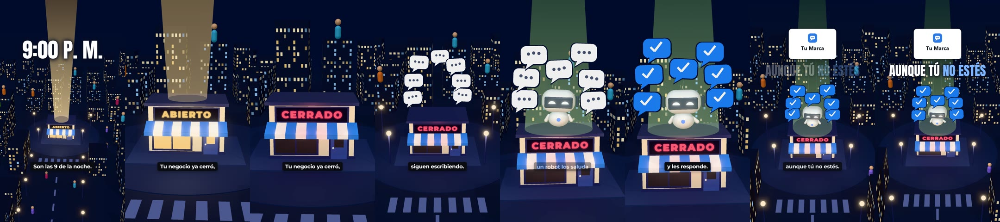
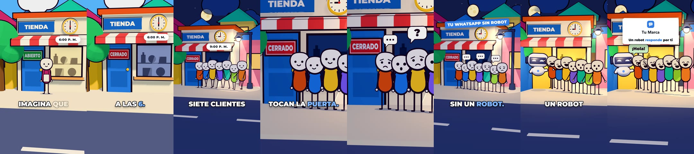

# videos_ia

Una habilidad para Claude Code que hace videos narrados para redes y anuncios: elige el formato, escribe el guion,
genera la voz, anima la escena en 3D, pone subtítulos y sonido, y revisa el resultado. Todo se renderiza en el equipo
con three.js en Chrome sin ventana y ffmpeg. No usa un generador de video.

## Qué hace

Seis formatos, cada uno con su receta y un ejemplo que corre:

| Formato | Para qué | Dura |
|---|---|---|
| Anuncio de producto | Mostrar el producto funcionando, para pauta o la web | 25–50 s |
| Diálogo con mascota | Responder dudas de compra, contar un resultado | 45–60 s |
| Presentador que explica | Enseñar un concepto con un ejemplo | 45–75 s |
| Mundo en miniatura | Explicar cómo funciona algo que no se ve | 60–130 s |
| Videojuego | Explicar un proceso por pasos | 30–45 s |
| Cuento con dibujos | Contar una anécdota o una comparación con remate | 55–70 s |





Salen en vertical 1080×1920 (Reels, TikTok, Shorts, estados de WhatsApp) y el anuncio de producto también en
horizontal 1920×1080. Cada archivo queda por debajo de 15 MB.

## Cómo está organizado

```
SKILL.md                  la habilidad: el flujo de diez pasos y las reglas
referencias/
  formatos.md             qué formato elegir y la receta de cada uno
  guion.md                gancho, ritmo, lo que no se puede decir, archivos del guion y de la marca, la voz
  escena.md               cómo se escribe la escena: zonas del cuadro, cámara, todas las piezas
  sonido-y-calidad.md     efectos y música, revisión cuadro por cuadro, armado, control de calidad
  varios-agentes.md       reparto entre agentes y plantillas de encargo
  errores-conocidos.md    síntoma, causa y arreglo
  analisis-referencias.md de dónde salen las reglas
kit/                      el motor, los scripts y un ejemplo por formato
ejemplos/                 cuadros de las pruebas de cada formato
```

## Instalar

La habilidad vive en esta carpeta. Para que Claude Code la encuentre desde cualquier proyecto, enlázala en la carpeta
de habilidades del usuario (PowerShell, una sola vez):

```powershell
New-Item -ItemType Junction -Path "$env:USERPROFILE\.claude\skills\videos-ia" -Target "<ruta a esta carpeta>"
```

En Mac o Linux: `ln -s "<ruta a esta carpeta>" ~/.claude/skills/videos-ia`.

Después, en cualquier proyecto: «haz un video sobre…» o `/videos-ia`.

## Requisitos

- Node 18 o más, Python 3.10 o más, Google Chrome, ffmpeg y ffprobe. Mejor con GPU.
- `pip install numpy`. Opcionales: `edge-tts` (voz gratis de respaldo) y `faster-whisper` (comprobar la pronunciación).
- Una clave de ElevenLabs para la voz, guardada fuera del repositorio (`referencias/guion.md` §6). Sin clave, el kit
  funciona con la voz gratuita de Microsoft: `VOZ_MOTOR=edge`.

## Probar que funciona

```bash
cp -r kit ~/videos-trabajo && cd ~/videos-trabajo      # fuera de OneDrive o Dropbox
npm install
VOZ_MOTOR=edge python guion.py demo                    # voz gratis, sin clave
bash fotos.sh demov 3 8 12                             # mira build/demov/hoja_1.jpg
bash armar.sh ../videos demo demov
```

## Lo que no hay aquí

- **Ninguna clave ni secreto.** La clave de voz sale de una variable de entorno o del almacén de secretos del equipo.
- **Ningún video.** Los MP4 se quedan en el equipo de quien los hace.
- **Ningún material de terceros.** Los videos que sirvieron de referencia se midieron y se describen en
  `referencias/analisis-referencias.md`; no se incluyen ni sus cuadros ni sus guiones.

## Créditos

- Las fórmulas de gancho y varias reglas de guion vienen de estudiar
  [`jakeschincariol/youtube-agent-skill`](https://github.com/jakeschincariol/youtube-agent-skill) (MIT).
- Las reglas de cámara, los niveles de sonido y la idea del control de calidad cuadro por cuadro vienen de estudiar
  [`mromidev/claude-animated-shorts`](https://github.com/mromidev/claude-animated-shorts) (MIT).
- El código de este repositorio es propio: no se copió código de ninguno de los dos.
