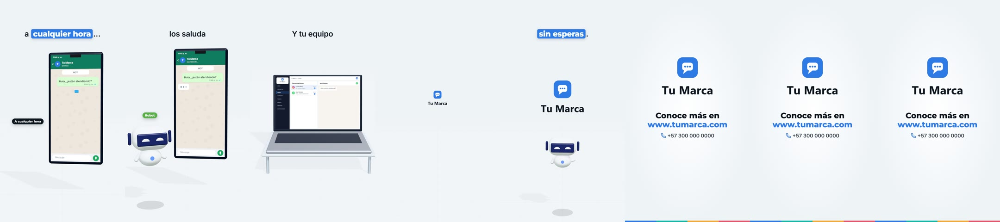
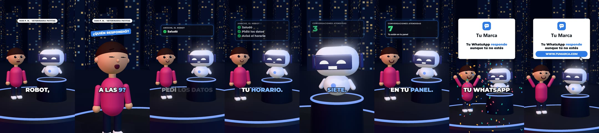
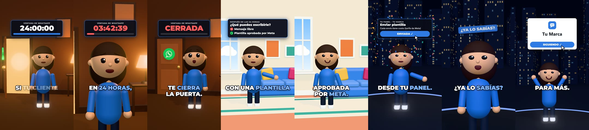
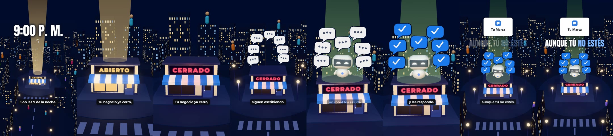
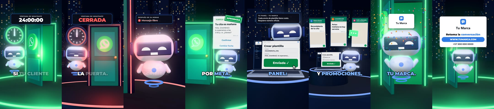
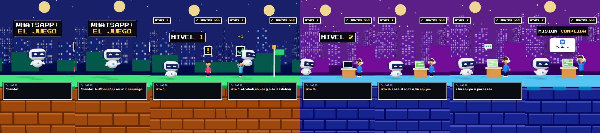
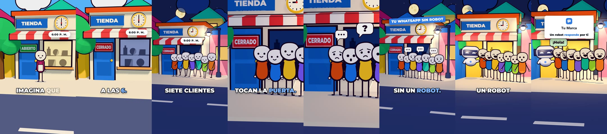

# Elegir el formato

Se elige **antes** de escribir una palabra del guion. El formato decide quién habla, cuánto dura, cómo se mueve la
cámara y qué aparece en pantalla.

## La tabla

| Si lo que quieres es… | Formato | Dura | Ejemplo en el kit |
|---|---|---|---|
| Mostrar el producto funcionando, para pauta o para la web | Anuncio de producto | 25–50 s | `anuncio-demo.js`, `ejemplos/` |
| Responder dudas de compra o contar un resultado | Diálogo con mascota | 45–60 s | `anuncio-dialogov.js` |
| Enseñar un concepto o una regla con un ejemplo | Presentador que explica | 45–75 s | `anuncio-presentav.js` |
| Explicar cómo funciona algo grande o que no se ve | Mundo en miniatura | 60–130 s | `anuncio-mundov.js` |
| Explicar un proceso por pasos | Videojuego | 20–45 s | `anuncio-juegov.js` |
| Enseñar una regla o un concepto, sin personas | Mascota que explica | 20–40 s | `anuncio-robotv.js` |
| Contar una anécdota o una comparación con remate | Cuento con dibujos | 55–70 s | `anuncio-cuentov.js` |
| Mostrar una pantalla real con una persona real | Persona a cámara | 30–60 s | No se anima: hay que grabar |

## Preferencias del dueño de esta habilidad (10 de noviembre de 2026)

Mandan sobre la tabla. Si otra persona usa esta habilidad, puede ignorar esta sección.

- **Nunca muñecos humanos en 3D.** Vio el diálogo y el presentador con el personaje humano del kit
  (`k.crearPersonaje`) y pidió no hacerlos más. Eso deja fuera esos dos formatos tal como están en los ejemplos.
  - El cliente y el equipo se muestran con objetos: celulares, globos de chat, portátiles con el panel, íconos,
    iniciales en un círculo.
  - Un diálogo o una explicación se pueden hacer con la mascota sola como presentadora (`anuncio-robotv.js`).
  - Las personas dibujadas en 2D del cuento sí valen: las pidió por nombre («el de dibujos»).
  - Por prudencia, tampoco figuras pequeñas en 3D (`k.crearMultitud`, `k.crearPersona`) mientras no diga otra cosa.
- **Su favorito es el anuncio de producto en 3D claro** (el celular, el panel y la mascota). Tras ver los formatos
  de redes dijo que le gustaban más esos «con las nuevas voces» y pidió diez más con otras bondades del manual. Es el
  formato por defecto para su marca, sin las personas sentadas de los ejemplos viejos.
- **Otros estilos que acepta:** videojuego, cuento con dibujos y 3D (mundo en miniatura, o la mascota con objetos).
- **Alternar la voz de hombre y la de mujer** entre un video y otro (`locutor` y `locutora`).
- **Cada videojuego se ve distinto:** plataformas, tablero de misión, pelea de jefe, portales. No repetir el mismo
  nivel con otro texto.

## Tres preguntas que deciden

1. **¿Dónde va?**
   - Pauta pagada, página web o presentación comercial → anuncio de producto.
   - Alcance orgánico en Reels, TikTok o Shorts → cualquiera de los otros. Ahí el video tiene que enseñar o entretener
     aunque el que mira no compre nada; la marca entra como quien lo cuenta.
2. **¿Qué forma tiene la idea?**
   - Pregunta y respuesta → diálogo.
   - Definición y ejemplo → presentador.
   - Mecanismo («cómo funciona…», «qué pasa cuando…») → mundo en miniatura.
   - Pasos en orden → videojuego.
   - Historia con remate → cuento.
3. **¿Quién habla?**
   - Dos voces → diálogo.
   - Una voz con cara → presentador.
   - Una voz sin cara → mundo, videojuego o cuento.

Si dos formatos sirven, gana el más sencillo de producir: diálogo y presentador reutilizan casi todo; mundo y cuento
piden construir objetos propios.

**Pregúntale al usuario solo lo que no puedes decidir:** dónde se va a publicar, el tema o producto, y los datos del
cierre. Propón tú el formato con la tabla y dile por qué.

## Lo que comparten los formatos de redes

1. **Gancho en 2 segundos**, con algo concreto. Sin saludo.
2. **Texto en pantalla desde el primer cuadro**, con palabras distintas a las de la voz.
3. **Cambia algo cada 1–2,5 s:** un corte, una tarjeta, un gesto, un número que sube.
4. **Ningún plano quieto:** si no corta, la cámara empuja despacio.
5. **Una idea por tramo y una imagen por idea.**
6. **Voz rápida y sin pausas.**
7. **Subtítulos grandes y cortos** hacia el 70 % del alto.
8. **Efectos de sonido** en lo que aparece, y una cama de música suave.
9. **Un solo pedido al final**, y el último segundo con la marca.
10. **Verticales**, 1080×1920.

---

## Anuncio de producto

- **Qué es:** el producto funcionando: el celular con el chat, el panel, la mascota. Claro y luminoso.
- **Estructura:** gancho (el problema en una frase) → entra el producto → de 1 a 3 cosas que se pueden mostrar → lema
  → cierre automático con logo, web y contacto.
- **Guion:** `"subtitulos": "arriba"` (o sin el campo), sin `sinCierre`. Voz a 2,0–2,4 palabras por segundo.
- **Imagen:** ambiente `dia`; cámara con `k.setKF`; subtítulos arriba; sale en horizontal y en vertical.
- **Piezas:** `crearChat` + `crearTelefono`, `crearPanelUI` + `crearPortatil`, `crearRobot`, `crearCanal`, `mostrar`.
- **Ojo:** es el formato con más riesgo de prometer de más. Cada texto del chat y del panel cuenta como afirmación.

## Diálogo con mascota

> El ejemplo usa el muñeco humano del kit. El dueño de esta habilidad pidió no usarlo: ver «Mascota que explica».

- **Qué es:** una persona que representa al espectador pregunta; la mascota de la marca responde. Frases cortas.
- **Estructura (45–60 s):**
  1. gancho: una pregunta con una cifra o un hecho concreto;
  2. de 4 a 7 pares de pregunta y respuesta, cada uno con su tarjeta;
  3. «¿y por qué funciona?» → la razón;
  4. reacción de la persona;
  5. cierre: la marca, un pedido y un botón.
- **Guion:** `"subtitulos": "karaoke"`, `"tono": "neon"`, `"sinCierre": true`, `"musica": "pulso"`; cada escena con su
  `habla`. Dos voces distintas.
- **Imagen:**
  - tarima con aro de luz, mascota en pedestal, ciudad tenue al fondo, dos luces de color;
  - `k.planos` con tres planos: general, primer plano de la persona, primer plano de la mascota;
  - corta al primer plano de quien empieza a hablar; vuelve al general cuando aparece una tarjeta;
  - la pregunta sale además en un `globo` sobre quien la hace;
  - tarjetas: lista que se arma, contador que sube, cifra grande.
- **Caras:** sorpresa en las preguntas, preocupación al principio, alegría al final; brazos arriba en el cierre.

## Presentador que explica

> El ejemplo usa el muñeco humano del kit. El dueño de esta habilidad pidió no usarlo: ver «Mascota que explica».

- **Qué es:** un solo personaje explica una regla o un término en 3 o 4 pasos.
- **Estructura (45–75 s):**
  1. gancho: una contradicción o una advertencia;
  2. «el culpable tiene nombre»: el término;
  3. la definición en una frase;
  4. un ejemplo con números redondos;
  5. la diferencia: A contra B;
  6. qué hacer;
  7. cierre: «¿ya lo sabías?» y un pedido.
- **Guion:** `"subtitulos": "karaoke"`, `"sinCierre": true`, `"musica": "pulso"`; una sola voz.
- **Imagen:**
  - **cada paso tiene su escenario y su paleta:** cuarto cálido y oscuro para el problema, sala clara para la
    explicación, tarima con luces para la solución. `k.tono(...)` por escena y corte seco al cambiar;
  - escenarios en x = −26, 0 y 26;
  - en cada escenario, un plano medio y un primer plano; corta una vez a mitad de cada escena;
  - una tarjeta por paso, arriba: reloj que baja, casillas ✕ y ✓, botón con cursor.
- **Caras:** la emoción cambia con el paso: preocupada, neutra que señala, feliz.

## Mundo en miniatura

- **Qué es:** un documental corto. Nadie habla a cámara: un narrador cuenta y cada frase se vuelve una metáfora en
  una ciudad pequeña vista desde arriba.
- **Estructura (60–130 s):**
  1. gancho que mete al espectador («son las 9 de la noche…», «tienes tres segundos…»);
  2. título gigante;
  3. cómo funciona, en 3 o 4 mecanismos, cada uno con su objeto;
  4. un giro;
  5. qué puede hacer el espectador;
  6. vuelta al gancho y un pedido de enviarlo a alguien.
- **Guion:** `"subtitulos": "pastilla"`, `"tono": "noche"`, `"sinCierre": true`, `"musica": "pad"`; trozos de 3 a 6
  palabras. Una sola voz.
- **Imagen:**
  - `crearCiudad` centrada, con un `claro` donde ocurre la acción; figuras pequeñas; faroles; haces de luz;
  - **un solo vuelo de cámara con `k.setKF`, sin cortes:** baja, se abre, se acerca, sube;
  - objetos simbólicos grandes y claros: una tienda con letrero, globos de chat que vuelan y se acumulan;
  - títulos `'titular'` de 2 o 3 palabras; casi ninguna tarjeta.
- **Ojo con la escala:** desde arriba todo se ve pequeño en 1080 px de ancho. Lo que importa tiene que ocupar al
  menos un tercio del ancho en su momento.

## Mascota que explica

- **Qué es:** la mascota de la marca es la presentadora. Explica una regla en tres o cuatro pasos y se mueve entre
  rincones de un mismo escenario oscuro con luces de color. No hay personas.
- **Estructura (20–40 s):** gancho con una advertencia → la regla → cómo lo resuelve el producto → para qué sirve →
  cierre con la marca.
- **Guion:** `"subtitulos": "karaoke"`, `"tono": "neon"`, `"sinCierre": true`, `"musica": "pulso"`; una sola voz, y
  la mascota mueve la boca con `k.boca(T, 'locutor')`.
- **Imagen:**
  - cada paso tiene su objeto grande: un reloj que cuenta atrás, una puerta que se cierra, una tarjeta con un sello,
    un portátil con el panel, mensajes que vuelan a varios celulares;
  - la luz cambia con el ánimo del paso: roja en el problema, verde en la solución;
  - `k.planos` con un plano general y un primer plano de la mascota; corte al cambiar de escena.
- Es el reemplazo del presentador humano y del diálogo cuando no se quieren muñecos.

## Videojuego

- **Qué es:** el proceso contado como un juego retro de plataformas, por niveles.
- **Estructura (30–45 s):** «X es un videojuego» → nivel 1 → nivel 2 → (nivel 3: el jefe final es el obstáculo) →
  «misión cumplida» y la marca.
- **Guion:** `"subtitulos": "caja"`, `"sinCierre": true`; **una frase entera por escena** (un solo trozo de hasta 9
  palabras) y sincronía con `k.w('escena', n)`. Voz más rápida.
- **Imagen:**
  - `k.pixelar(5)`; vista lateral; plataforma con ladrillos; cada nivel con su color de fondo;
  - la mascota recorre el nivel a saltos y «recoge» lo que la frase dice;
  - marcador arriba (dos tarjetas `'pix'`: nivel y contador), rótulos «NIVEL n», «MISIÓN CUMPLIDA»;
  - la acción va entre y 420 y y 1150: abajo está el cuadro de diálogo.
- **Sonido:** `moneda` al recoger, `nivel` al cambiar de nivel; el «bip» de cada palabra sale solo. Sin música.
- **Cuatro variantes probadas** (10 de noviembre de 2026), para que dos videojuegos no se vean iguales:

  | Variante | Cómo se ve | Sirve para |
  |---|---|---|
  | Plataformas | Vista lateral; la mascota salta de izquierda a derecha y cada nivel cambia de color | Un recorrido con varias paradas |
  | Tablero de misión | Casillas vistas en diagonal, de día; la mascota avanza casilla a casilla | Una tarea con pasos que se preparan |
  | Pelea de jefe | Arena oscura; el problema es un jefe con barra de vida que baja con cada nivel | Un problema que se resuelve por etapas |
  | Portales | Tres puertas de colores con rótulo; algo vuela hasta la que corresponde | Repartir entre opciones |

- En el ejemplo del kit los clientes son celulares con un globo de chat y el equipo es un portátil con el panel.

## Cuento con dibujos

- **Qué es:** una historia corta con personajes 2D de dibujo dentro de un mundo 3D de colores planos y contorno de
  tinta. La variante para marca usa «imagina que…» en vez de una historia real.
- **Estructura (55–70 s):** paradoja o «imagina que…» en la primera frase → lugar y hora en una línea → de 3 a 6
  pasos que escalan → una pausa cómica → «así se ve…» o «verás,» y la explicación con una comparación cotidiana →
  remate. Termina en la última palabra.
- **Guion:** `"subtitulos": "karaoke"`, `"tono": "cielo"`, `"sinCierre": true`, `"musica": "pad"`; trozos de 1 a 3
  palabras. Voz rápida.
- **Imagen:**
  - personajes como carteles que miran a la cámara: cabeza de frijol, ojos de punto, cuerpo de cápsula de color,
    brazos y piernas de trazo, contorno ciruela; unas 3,5 cabezas de alto; rebotan al caminar;
  - mundo de cajas con contorno negro (casco invertido), cielo saturado, paso de día a noche con `k.tono`;
  - casi sin cortes: deslizamientos de 0,6–1,3 s y empuje lento;
  - cada frase se ilustra al pie de la letra; los objetos llevan el chiste.
- **Para historias reales completas** con este estilo (mundo pintado, desenfoque de fondo, música de marcha) existe
  una habilidad pública aparte, `mromidev/claude-animated-shorts`, que usa Remotion.

## Persona a cámara con pantalla

- **Qué es:** una persona real habla a cámara y alterna con la grabación de su pantalla.
- **Cuándo:** la prueba es una pantalla real y alguien está dispuesto a grabarse.
- **El kit no la anima.** Lo que sí se puede preparar: el guion con gancho, el rótulo gigante del primer segundo, la
  lista de tomas de pantalla y los subtítulos.
- **Estructura (30–60 s):** rótulo y frase en contra («deja de…») → qué hago yo en cambio → un ejemplo en pantalla →
  la recomendación → un pedido («comenta la palabra…»).

---

## Lo que cambia entre formatos, en una tabla

| | Subtítulos | Ambiente | Cámara | Voces | Música | Cierre |
|---|---|---|---|---|---|---|
| Anuncio | `arriba` | `dia` | `setKF` | 1 | No | Automático |
| Diálogo | `karaoke` | `neon` | `planos`, corte por voz | 2 | `pulso` | Tarjeta con botón |
| Presentador | `karaoke` | Uno por paso | `planos`, corte por paso | 1 | `pulso` | «¿Ya lo sabías?» |
| Mundo | `pastilla` | `noche` | `setKF`, un vuelo | 1 | `pad` | Titular y logo |
| Videojuego | `caja` | `neon` | Lateral, sigue a la mascota | 1 | No | «Misión cumplida» |
| Mascota que explica | `karaoke` | `neon`, luz por paso | `planos`, corte por paso | 1 | `pulso` | Tarjeta con botón |
| Cuento | `karaoke` | `cielo` → `noche` | `setKF`, deslizamientos | 1 | `pad` | Remate y logo |

## Prueba antes del video completo

Para un formato o una marca nuevos, haz primero una **prueba de 12–15 s** (4 o 5 escenas, unos 200 caracteres de
voz) y muéstrasela al usuario. Así se hicieron las cinco pruebas del 10 de noviembre de 2026. Aprobada la prueba, el
video completo reutiliza el escenario, los planos y las piezas.
